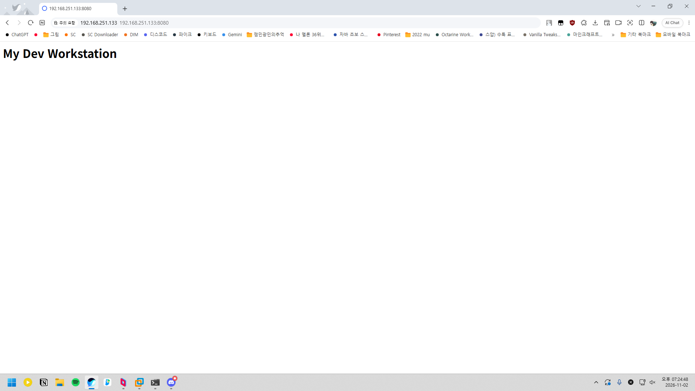
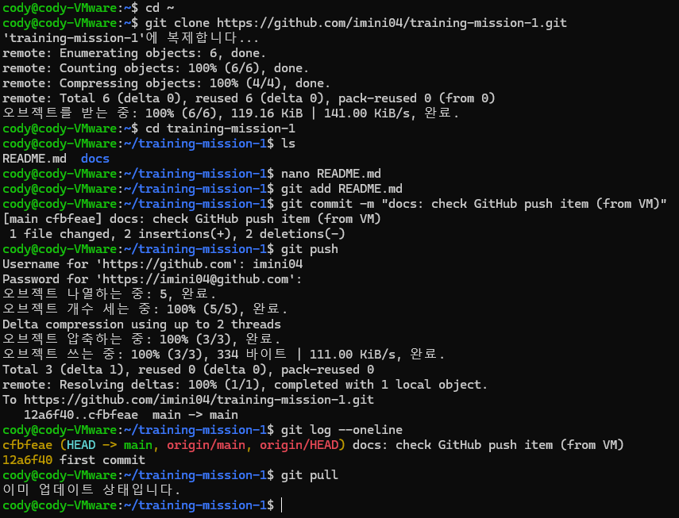

# 내 컴퓨터에 개발자용 '작업실' 꾸미기

## 1. 프로젝트 개요
로컬 개발 환경의 재현성 확보를 위해 리눅스 CLI 환경 조작, Docker 컨테이너 가상화, 데이터 영속성(Volume/Bind Mount) 제어, Git/GitHub 협업 환경을 구축하고 이를 검증한 엔지니어링 리포트입니다.
모든 실습은 VMware 위의 Ubuntu 가상머신(`cody-VMware`)에서 진행했습니다.
- `~/workstation-lab`: 터미널 기본 조작 및 권한 실습용 폴더 (4장)
- `~/test`: Docker 웹 서버(`app/`, `Dockerfile`)와 Git 저장소 폴더. 이 GitHub 저장소의 내용입니다 (5~8장)

**저장소 구성**
```
.
├── README.md                 # 이 기술 문서
├── Dockerfile                # 커스텀 NGINX 이미지 정의
├── app/
│   └── index.html            # 웹 서버 정적 페이지
└── docs/screenshots/         # 브라우저 접속, VSCode 연동 캡처
```

---

## 2. 실행 환경
| 항목 | 사양 / 버전 | 비고 |
| :--- | :--- | :--- |
| **OS** | Ubuntu 24.04.4 LTS (Kernel 7.0.0-42-generic) | VMware 가상머신, x86_64 |
| **Shell / Terminal** | bash | |
| **Docker Engine** | 29.9.2 (build a82e528) | `docker --version` |
| **Docker Buildx / Compose** | v0.38.1 / v5.6.1 | `docker info` Plugins |
| **Git** | 2.43.0 | `git --version` |
| **리소스** | CPU 2코어 / 메모리 5.7GiB | `docker info` |

---

## 3. 수행 체크리스트
- [x] 터미널 기본 조작 및 작업 디렉토리 관리 (`mkdir`, `pwd`, `cp`, `mv`, `rm`, `touch`, `ls -la`)
- [x] 파일 및 디렉토리 권한 설정 실습 (`chmod 600`, `chmod 700`)
- [x] Docker 설치 (공식 apt 저장소) 및 데몬/CLI 점검 (`docker info`, `hello-world`)
- [x] Docker 운영 명령 (`images`, `ps`, `ps -a`, `logs`, `stats`, `stop`, `start`)
- [x] Ubuntu 컨테이너 실행 및 `attach` vs `exec` 종료 동작 비교
- [x] Dockerfile 기반 커스텀 NGINX 웹 서버 이미지 빌드 (`my-web:1.0`)
- [x] 호스트-컨테이너 포트 포워딩 (`-p 8080:80`) 및 브라우저 접속
- [x] 바인드 마운트 실시간 변경 검증 (`-v $(pwd)/app:/usr/share/nginx/html`)
- [x] Named Volume 데이터 영속성 검증 (컨테이너 삭제 전/후 비교)
- [x] Git 사용자 정보·기본 브랜치(`main`) 설정 및 로컬 커밋
- [x] VSCode GitHub 로그인 및 원격 저장소 연동(push)
- [x] 트러블슈팅 2건 기록 및 분석

### 검증 방법 요약
| 검증 항목 | 사용한 명령 | 확인한 결과 | 결과 위치 |
| :--- | :--- | :--- | :--- |
| 터미널 조작 | `pwd`, `ls -la`, `cp`, `mv`, `rm` | 숨김 파일 표시, 복사·이름 변경·삭제 반영 | [4.1](#41-cli-기본-명령어-조작), [4.3](#43-파일-삭제) |
| 권한 변경 | `ls -l`, `ls -ld`, `chmod` | 파일 `rw-rw-r--` → `rw-------`, 폴더 `rwxrwxr-x` → `rwx------` | [4.2](#42-권한permission-변경-실습) |
| Docker 설치·데몬 | `docker --version`, `docker info` | Client/Server 모두 29.9.2 응답 | [5.2](#52-docker-데몬-점검) |
| 기본 컨테이너 | `docker run hello-world`, `docker exec` | `Hello from Docker!`, 컨테이너 내부 `ls`·`uname` 실행 | [5.3](#53-기본-실행-테스트-hello-world--ubuntu) |
| attach vs exec | `docker attach`, `docker exec`, `docker ps -a` | attach 종료 시 `Exited (0)`, exec 종료 후에도 `Up` | [5.5](#55-attach-vs-exec-직접-비교) |
| 커스텀 이미지 | `docker build`, `docker inspect` | Labels·Env에 커스텀 값 반영 | [6.2](#62-이미지-빌드-및-커스텀-적용-확인) |
| 포트 매핑 | `docker run -p 8080:80`, `curl`, 브라우저 | `My Dev Workstation` 응답 + 브라우저 캡처 | [6.3](#63-포트-매핑-실행-및-접속-검증) |
| 운영 명령 | `docker logs`, `docker stats`, `docker stop/start` | NGINX 기동 로그, 리소스 사용량, 상태 변화 | [6.4](#64-컨테이너-운영-명령-logs--stats--stop--start) |
| 바인드 마운트 | `-v $(pwd)/app:...`, `curl` | 호스트 수정이 재시작 없이 8081에 반영, 8080은 그대로 | [7.1](#71-바인드-마운트bind-mount-즉시-반영-검증) |
| 볼륨 영속성 | `docker volume create`, `docker rm -f`, `cat` | 컨테이너 삭제 전/후 모두 `preserved file` | [7.2](#72-docker-named-volume-영속성-검증) |
| Git 설정·연동 | `git config --list`, `git branch` | `init.defaultbranch=main`, `* main`, VSCode 연동 캡처 | [8](#8-git-설정-및-github-연동) |

---

## 4. 터미널 조작 및 권한 실습

### 4.1 CLI 기본 명령어 조작
```bash
# 1. 작업 디렉토리 생성 및 이동
cody@cody-VMware:~$ mkdir -p ~/workstation-lab && cd ~/workstation-lab

# 2. 현재 위치 확인 (절대 경로)
cody@cody-VMware:~/workstation-lab$ pwd
/home/cody/workstation-lab

# 3. 파일 생성 및 내용 확인
cody@cody-VMware:~/workstation-lab$ echo "Hello" > test.txt
cody@cody-VMware:~/workstation-lab$ cat test.txt
Hello

# 4. 파일 복사 및 이름 변경
cody@cody-VMware:~/workstation-lab$ cp test.txt test_copy.txt
cody@cody-VMware:~/workstation-lab$ mv test_copy.txt test_renamed.txt

# 5. 숨김 파일 생성 및 전체 목록 확인
cody@cody-VMware:~/workstation-lab$ touch .env.test
cody@cody-VMware:~/workstation-lab$ ls -la
합계 16
drwxrwxr-x  2 cody cody 4096 10월 31 21:46 .
drwxr-x--- 16 cody cody 4096 10월 31 21:44 ..
-rw-rw-r--  1 cody cody    0 10월 31 21:46 .env.test
-rw-rw-r--  1 cody cody    6 10월 31 21:45 test.txt
-rw-rw-r--  1 cody cody    6 10월 31 21:45 test_renamed.txt
```
> **확인 포인트:** `ls -la`의 `-a` 옵션으로 `.`으로 시작하는 숨김 파일(`.env.test`)과 현재(`.`)/상위(`..`) 디렉토리 항목까지 모두 표시됨을 확인했습니다. `cp`로 복사한 `test_copy.txt`는 `mv`에 의해 `test_renamed.txt`로 이름이 바뀌어 목록에 남아 있습니다.

### 4.2 권한(Permission) 변경 실습
```bash
# 1. 파일 권한 변경 (664 -> 600)
$ ls -l test.txt
-rw-rw-r-- 1 cody cody 6 10월 31 21:45 test.txt
$ chmod 600 test.txt
$ ls -l test.txt
-rw------- 1 cody cody 6 10월 31 21:45 test.txt

# 2. 디렉토리 권한 변경 (775 -> 700)
$ mkdir my_folder
$ ls -ld my_folder
drwxrwxr-x 2 cody cody 4096 10월 31 21:50 my_folder
$ chmod 700 my_folder
$ ls -ld my_folder
drwx------ 2 cody cody 4096 10월 31 21:50 my_folder
```
> **관찰 정리:** 과제 안내에는 기본 권한이 파일 644 / 디렉토리 755로 되어 있었으나, 실제 Ubuntu 일반 사용자 환경에서는 `umask 002`가 적용되어 파일 **664**(`rw-rw-r--`), 디렉토리 **775**(`rwxrwxr-x`)로 생성되었습니다. `chmod` 이후에는 각각 소유자만 접근 가능한 `600`, `700`으로 변경됨을 확인했습니다.

### 4.3 파일 삭제
```bash
# 삭제 전
cody@cody-VMware:~$ cd ~/workstation-lab && ls -la
합계 20
drwxrwxr-x  3 cody cody 4096 10월 31 21:50 .
drwxr-x--- 18 cody cody 4096 11월  2 18:39 ..
-rw-rw-r--  1 cody cody    0 10월 31 21:46 .env.test
drwx------  2 cody cody 4096 10월 31 21:50 my_folder
-rw-------  1 cody cody    6 10월 31 21:45 test.txt
-rw-rw-r--  1 cody cody    6 10월 31 21:45 test_renamed.txt

# 삭제
cody@cody-VMware:~/workstation-lab$ rm test_renamed.txt

# 삭제 후
cody@cody-VMware:~/workstation-lab$ ls -la
합계 16
drwxrwxr-x  3 cody cody 4096 11월  2 19:32 .
drwxr-x--- 18 cody cody 4096 11월  2 18:39 ..
-rw-rw-r--  1 cody cody    0 10월 31 21:46 .env.test
drwx------  2 cody cody 4096 10월 31 21:50 my_folder
-rw-------  1 cody cody    6 10월 31 21:45 test.txt
```
> **확인 포인트:** `rm` 이후 `test_renamed.txt`가 목록에서 사라졌습니다. 앞 단계에서 바꾼 권한(`test.txt`는 `-rw-------`, `my_folder`는 `drwx------`)도 그대로 유지되고 있습니다.

---

## 5. Docker 설치 점검 및 기본 컨테이너 운영

### 5.1 Docker 설치 (공식 apt 저장소)
```bash
# 1. 사전 패키지 설치
sudo apt-get update
sudo apt-get install -y ca-certificates curl gnupg

# 2. Docker 공식 GPG 키 등록
sudo install -m 0755 -d /etc/apt/keyrings
curl -fsSL https://download.docker.com/linux/ubuntu/gpg | sudo gpg --dearmor -o /etc/apt/keyrings/docker.gpg
sudo chmod a+r /etc/apt/keyrings/docker.gpg

# 3. Docker apt 저장소 추가
echo \
  "deb [arch=$(dpkg --print-architecture) signed-by=/etc/apt/keyrings/docker.gpg] https://download.docker.com/linux/ubuntu \
  $(. /etc/os-release && echo "$VERSION_CODENAME") stable" | \
  sudo tee /etc/apt/sources.list.d/docker.list > /dev/null

# 4. Docker Engine 및 플러그인 설치
sudo apt-get update
sudo apt-get install -y docker-ce docker-ce-cli containerd.io docker-buildx-plugin docker-compose-plugin

# 5. sudo 없이 docker 명령을 쓰기 위해 docker 그룹에 사용자 추가
sudo usermod -aG docker $USER
newgrp docker
```

### 5.2 Docker 데몬 점검
```bash
$ docker --version
Docker version 29.9.2, build a82e528

$ docker info
Client: Docker Engine - Community
 Version:    29.9.2
 Context:    default
 Debug Mode: false
 Plugins:
  buildx: Docker Buildx (Docker Inc.)
    Version:  v0.38.1
    Path:     /usr/libexec/docker/cli-plugins/docker-buildx
  compose: Docker Compose (Docker Inc.)
    Version:  v5.6.1
    Path:     /usr/libexec/docker/cli-plugins/docker-compose

Server:
 Containers: 3
  Running: 0
  Paused: 0
  Stopped: 3
 Images: 3
 Server Version: 29.9.2
 Storage Driver: overlayfs
  driver-type: io.containerd.snapshotter.v1
 Logging Driver: json-file
 Cgroup Driver: systemd
 Cgroup Version: 2
 Plugins:
  Volume: local
  Network: bridge host ipvlan macvlan null overlay
  Log: awslogs fluentd gcplogs gelf journald json-file local splunk syslog
 CDI spec directories:
  /etc/cdi
  /var/run/cdi
 Swarm: inactive
 Runtimes: io.containerd.runc.v2 runc
 Default Runtime: runc
 Init Binary: docker-init
 containerd version: b7a25261e029d68978bbf290df0a62fc819b3c51
 runc version: v1.5.2-0-g29dd3dc2
 init version: de40ad0
 Security Options:
  apparmor
   Profile: default
  seccomp
   Profile: builtin
  cgroupns
 Kernel Version: 7.0.0-42-generic
 Operating System: Ubuntu 24.04.4 LTS
 OSType: linux
 Architecture: x86_64
 CPUs: 2
 Total Memory: 5.736GiB
 Name: cody-VMware
 ID: 9a81297c-83c8-412e-a733-5e18faca4b37
 Docker Root Dir: /var/lib/docker
 Debug Mode: false
 Experimental: false
 Insecure Registries:
  127.0.0.0/8
  ::1/128
 Live Restore Enabled: false
 Firewall Backend: iptables
  EnableUserlandProxy: true
  UserlandProxyPath: /usr/bin/docker-proxy
```
> **확인 포인트:** Client와 Server 버전이 모두 29.9.2로 출력되어 CLI가 데몬과 정상 통신함을 확인했습니다. (데몬이 꺼져 있으면 Server 섹션에서 오류가 발생합니다.)

### 5.3 기본 실행 테스트 (hello-world & ubuntu)
```bash
# 1. hello-world 테스트
$ docker run --rm hello-world
Hello from Docker!
This message shows that your installation appears to be working correctly.
...

# 2. Ubuntu 컨테이너 백그라운드 실행
$ docker run -dit --name my-ubuntu ubuntu:latest
Unable to find image 'ubuntu:latest' locally
latest: Pulling from library/ubuntu
f3f25b84a7d7: Pull complete
edafa32f5d9e: Pull complete
Status: Downloaded newer image for ubuntu:latest
513d1a6e7e80e338147aa653e0699c8b8d91bc1639999ef93fbcf2cd3ea02e6c

# 3. 실행 상태 확인
$ docker ps
CONTAINER ID   IMAGE           COMMAND       CREATED              STATUS              PORTS     NAMES
513d1a6e7e80   ubuntu:latest   "/bin/bash"   About a minute ago   Up About a minute             my-ubuntu

# 4. exec로 컨테이너 내부 명령 실행
$ docker exec -it my-ubuntu bash -c "ls -la && uname -a"
total 60
drwxr-xr-x   1 root root 4096 Nov  1 10:51 .
drwxr-xr-x   1 root root 4096 Nov  1 10:51 ..
-rwxr-xr-x   1 root root    0 Nov  1 10:51 .dockerenv
lrwxrwxrwx   1 root root    7 Apr 20  2026 bin -> usr/bin
drwxr-xr-x   1 root root 4096 Nov  1 10:51 etc
drwxr-xr-x   3 root root 4096 Oct 25 10:26 home
...
drwxr-xr-x  12 root root 4096 Oct 25 10:24 usr
drwxr-xr-x  11 root root 4096 Oct 25 10:26 var
Linux 513d1a6e7e80 7.0.0-42-generic #42~24.04.1-Ubuntu SMP PREEMPT_DYNAMIC Mon Oct 19 14:43:01 UTC 2 x86_64 GNU/Linux

# 5. 실습 완료 후 정리
$ docker rm -f my-ubuntu
my-ubuntu
```
> **관찰 정리:**
> - 컨테이너 루트(`/`)에 `.dockerenv` 파일이 존재하여 컨테이너 내부임을 확인할 수 있습니다.
> - `uname -a`의 커널 버전(`7.0.0-42-generic`)이 호스트와 동일합니다. 컨테이너는 VM과 달리 **호스트 커널을 공유**하고 파일시스템·프로세스만 격리한다는 것을 보여줍니다.
> - 호스트명이 컨테이너 ID 앞 12자리(`513d1a6e7e80`)로 설정됩니다.

### 5.4 컨테이너 목록 확인 (`docker ps` vs `docker ps -a`)
```bash
$ docker ps
CONTAINER ID   IMAGE        COMMAND                   CREATED         STATUS         PORTS                                     NAMES
d9636cb95a8f   my-web:1.0   "/docker-entrypoint.…"   3 minutes ago   Up 3 minutes   0.0.0.0:8080->80/tcp, [::]:8080->80/tcp   web-8080

$ docker ps -a
CONTAINER ID   IMAGE        COMMAND                   CREATED         STATUS                      PORTS                                     NAMES
d9636cb95a8f   my-web:1.0   "/docker-entrypoint.…"   3 minutes ago   Up 3 minutes                0.0.0.0:8080->80/tcp, [::]:8080->80/tcp   web-8080
d5f64f688328   ubuntu       "sleep infinity"          23 hours ago    Exited (137) 22 hours ago                                             data-box2
```
> **확인 포인트:** `docker ps`는 실행 중(`Up`)인 컨테이너만, `docker ps -a`는 종료된(`Exited`) 컨테이너까지 모두 보여줍니다.

### 5.5 `attach` vs `exec` 직접 비교
```bash
# [A] attach: 메인 프로세스(bash)에 직접 연결
$ docker run -dit --name attach-test ubuntu bash
e675a114d809486a7a9e5a70db7f191b5a9c7dc3e91f414e85c85f861b8c3c32
$ docker attach attach-test
root@e675a114d809:/# echo hello
hello
root@e675a114d809:/# ls
bin  boot  dev  etc  home  lib  lib64  media  mnt  opt  proc  root  run  sbin  srv  sys  tmp  usr  var
root@e675a114d809:/# exit
$ docker ps -a | grep attach-test
e675a114d809   ubuntu   "bash"   25 seconds ago   Exited (0) 7 seconds ago   attach-test

# [B] exec: 실행 중인 컨테이너에 새 bash 프로세스를 추가로 띄움
$ docker run -dit --name exec-test ubuntu bash
8a203b630d232cb338f9507f1485f6a05781207359ea642ef46e5682bfac7aa1
$ docker exec -it exec-test bash
root@8a203b630d23:/# echo hello
hello
root@8a203b630d23:/# exit
$ docker ps | grep exec-test
8a203b630d23   ubuntu   "bash"   13 seconds ago   Up 12 seconds   exec-test
```
> **관찰 결과:**
> - `attach`로 들어가 `exit`하자 `attach-test`는 **`Exited (0)`** 상태가 되었습니다. attach는 컨테이너의 메인 프로세스(PID 1, bash)에 직접 연결되므로, 그 bash를 종료하면 컨테이너도 함께 종료됩니다.
> - `exec`로 들어가 `exit`한 뒤에도 `exec-test`는 **`Up`** 상태를 유지했습니다. exec는 메인 프로세스와 별개의 새 bash를 띄우므로, 그 셸을 종료해도 메인 프로세스와 컨테이너는 영향을 받지 않습니다.
> - 따라서 운영 중인 컨테이너를 점검할 때는 컨테이너를 멈출 위험이 없는 `exec`를 사용하는 것이 안전합니다.

---

## 6. 커스텀 웹 서버 컨테이너화 및 포트 매핑

### 6.1 소스코드 및 Dockerfile
```bash
$ mkdir -p app
$ echo "<h1>My Dev Workstation</h1>" > app/index.html
```

* `Dockerfile`
```dockerfile
FROM nginx:alpine
LABEL org.opencontainers.image.title="my-custom-nginx"
ENV APP_ENV=dev
COPY app/ /usr/share/nginx/html/
EXPOSE 80

```
| 지시어 | 역할 |
| :--- | :--- |
| `FROM nginx:alpine` | 경량 Alpine 기반 NGINX 공식 이미지를 베이스로 사용 |
| `LABEL org.opencontainers.image.title="my-custom-nginx"` | 이미지에 메타데이터(제목, 설명, 관리자 정보 등)를 키-값 형태로 기록 |
| `ENV APP_ENV=dev` | 실행 모드(개발/운영)를 코드 수정 없이 환경 변수로 구분하기 위함 |
| `COPY app/ ...` | 호스트의 `app/` 정적 파일을 NGINX 기본 웹 루트로 복사 |
| `EXPOSE 80` | 컨테이너가 80 포트를 사용함을 문서화 (실제 공개는 `-p`로 수행) |

### 6.2 이미지 빌드 및 커스텀 적용 확인
```bash
$ docker build -t my-web:1.0 .
[+] Building 2.8s (7/7) FINISHED                                    docker:default
 => [internal] load build definition from Dockerfile                          0.0s
 => [internal] load metadata for docker.io/library/nginx:alpine               1.5s
 => [internal] load .dockerignore                                             0.0s
 => [internal] load build context                                             0.0s
 => CACHED [1/2] FROM docker.io/library/nginx:alpine@sha256:785835ea65db...   0.0s
 => [2/2] COPY app/ /usr/share/nginx/html/                                    0.0s
 => exporting to image                                                        1.1s
 => => naming to docker.io/library/my-web:1.0                                 0.0s

$ docker images
IMAGE                ID             DISK USAGE   CONTENT SIZE   EXTRA
hello-world:latest   c567b231f656       25.9kB         9.49kB
my-web:1.0           2f174e92ea04       93.6MB         26.3MB
ubuntu:latest        6a06111c3b0a        163MB         45.9MB    U

# 커스텀 포인트(LABEL, ENV)가 이미지에 반영됐는지 확인
$ docker inspect my-web:1.0 --format '{{json .Config.Labels}} {{json .Config.Env}}'
{"maintainer":"NGINX Docker Maintainers <docker-maint@nginx.com>","org.opencontainers.image.title":"my-custom-nginx"} ["PATH=/usr/local/sbin:/usr/local/bin:/usr/sbin:/usr/bin:/sbin:/bin","NGINX_VERSION=1.31.8","PKG_RELEASE=1","DYNPKG_RELEASE=1","NJS_VERSION=1.0.2","NJS_RELEASE=1","ACME_VERSION=0.4.1","APP_ENV=dev"]
```
> **확인 포인트:** 빌드 로그에는 `COPY`만 단계로 표시됩니다. `LABEL`, `ENV`는 파일시스템 레이어를 만들지 않는 메타데이터 지시어이기 때문입니다. 대신 `docker inspect`로 확인한 결과 Labels에 `org.opencontainers.image.title=my-custom-nginx`, Env에 `APP_ENV=dev`가 들어가 있어 커스텀 포인트가 정상 반영되었음을 확인했습니다.

### 6.3 포트 매핑 실행 및 접속 검증
```bash
# 이전 이미지로 떠 있던 컨테이너 정리 후 새 이미지로 재실행 (Host 8080 -> Container 80)
$ docker rm -f web-8080 web-bind
web-8080
$ docker run -d -p 8080:80 --name web-8080 my-web:1.0
290e9850fb4df0c48f81befb278a5e4572fd93f47b2e4f4d790090d346460b20

# 실행 직후 바로 접속 → 실패 (트러블슈팅 이슈 1 참고)
$ curl http://localhost:8080
curl: (56) Recv failure: 상대편이 연결을 끊음

# 잠시 후 재접속 → 성공
$ curl http://localhost:8080
<h1>My Dev Workstation</h1>
```
> **브라우저 접속 화면 증거:**
> 
> VM 외부(Windows 호스트)의 브라우저에서 VM의 IP와 호스트 포트(`192.168.251.133:8080`)로 접속해 `My Dev Workstation` 페이지가 표시됨을 확인했습니다. `-p 8080:80` 포트 매핑으로 VM 바깥의 요청까지 컨테이너 내부 80 포트로 전달된다는 것을 보여 줍니다.

### 6.4 컨테이너 운영 명령 (logs / stats / stop / start)
```bash
# 실행 상태 확인
$ docker ps
CONTAINER ID   IMAGE        COMMAND                   CREATED                  STATUS                  PORTS                                     NAMES
290e9850fb4d   my-web:1.0   "/docker-entrypoint.…"   Less than a second ago   Up Less than a second   0.0.0.0:8080->80/tcp, [::]:8080->80/tcp   web-8080
8a203b630d23   ubuntu       "bash"                    6 minutes ago            Up 6 minutes                                                      exec-test

# 컨테이너 로그 확인
$ docker logs web-8080
/docker-entrypoint.sh: /docker-entrypoint.d/ is not empty, will attempt to perform configuration
/docker-entrypoint.sh: Looking for shell scripts in /docker-entrypoint.d/
/docker-entrypoint.sh: Launching /docker-entrypoint.d/10-listen-on-ipv6-by-default.sh
10-listen-on-ipv6-by-default.sh: info: Getting the checksum of /etc/nginx/conf.d/default.conf
10-listen-on-ipv6-by-default.sh: info: Enabled listen on IPv6 in /etc/nginx/conf.d/default.conf
/docker-entrypoint.sh: Sourcing /docker-entrypoint.d/15-local-resolvers.envsh
/docker-entrypoint.sh: Launching /docker-entrypoint.d/20-envsubst-on-templates.sh
/docker-entrypoint.sh: Launching /docker-entrypoint.d/30-tune-worker-processes.sh
/docker-entrypoint.sh: Configuration complete; ready for start up
2026/11/02 10:13:44 [notice] 1#1: using the "epoll" event method
2026/11/02 10:13:44 [notice] 1#1: nginx/1.31.8
2026/11/02 10:13:44 [notice] 1#1: built by gcc 15.2.0 (Alpine 15.2.0)
2026/11/02 10:13:44 [notice] 1#1: OS: Linux 7.0.0-42-generic
2026/11/02 10:13:44 [notice] 1#1: getrlimit(RLIMIT_NOFILE): 1024:524288
2026/11/02 10:13:44 [notice] 1#1: start worker processes
2026/11/02 10:13:44 [notice] 1#1: start worker process 30
2026/11/02 10:13:44 [notice] 1#1: start worker process 31

# 리소스 사용량 확인 (1회 스냅샷)
$ docker stats --no-stream
CONTAINER ID   NAME        CPU %     MEM USAGE / LIMIT     MEM %     NET I/O         BLOCK I/O     PIDS
290e9850fb4d   web-8080    0.00%     3.332MiB / 5.736GiB   0.06%     1.79kB / 222B   0B / 8.19kB   3
8a203b630d23   exec-test   0.00%     1008KiB / 5.736GiB    0.02%     3.49kB / 126B   0B / 4.1kB    1

# 컨테이너 중지 후 전체 목록 확인
$ docker stop web-8080
web-8080
$ docker ps -a
CONTAINER ID   IMAGE        COMMAND                   CREATED         STATUS                              PORTS     NAMES
290e9850fb4d   my-web:1.0   "/docker-entrypoint.…"   3 seconds ago   Exited (0) Less than a second ago             web-8080
8a203b630d23   ubuntu       "bash"                    6 minutes ago   Up 6 minutes                                  exec-test
e675a114d809   ubuntu       "bash"                    7 minutes ago   Exited (0) 6 minutes ago                      attach-test
d5f64f688328   ubuntu       "sleep infinity"          23 hours ago    Exited (137) 22 hours ago                     data-box2

# 다시 시작
$ docker start web-8080
web-8080
```
> **확인 포인트:**
> - `docker logs`에서 마지막 `Configuration complete; ready for start up` 이후 worker 프로세스 2개(30, 31)가 시작되어 NGINX가 정상 기동했음을 확인했습니다.
> - `docker stats`에서 NGINX 컨테이너는 메모리 약 3.3MiB, PIDS 3(master 1 + worker 2)으로 매우 가볍게 동작합니다.
> - `docker stop` 후 `docker ps -a`에서 `Exited (0)`(정상 종료)로 바뀌었고, `docker start`로 같은 컨테이너를 재사용해 다시 실행했습니다.

---

## 7. 스토리지: 바인드 마운트 & 볼륨 영속성

### 7.1 바인드 마운트(Bind Mount) 즉시 반영 검증
호스트의 `app/` 디렉토리를 컨테이너 웹 루트에 직접 연결하여, 호스트 수정 내용이 재빌드·재시작 없이 반영되는지 확인합니다.
```bash
# 호스트 디렉토리 마운트 실행
$ docker run -d -p 8081:80 --name web-bind -v $(pwd)/app:/usr/share/nginx/html my-web:1.0
8930ee3d3588e7eb016e7f5a74f6cb0d2073224d88da83f29631e1faa58840e0

# 1. 변경 전: 호스트 파일 내용과 컨테이너 응답이 같음
$ cat app/index.html
<h1>Live Update Success</h1>
$ curl http://localhost:8081
<h1>Live Update Success</h1>

# 2. 호스트에서 파일 수정
$ echo "<h1>Bind Mount Updated</h1>" > app/index.html

# 3. 변경 후: 재빌드/재시작 없이 바로 반영됨
$ curl http://localhost:8081
<h1>Bind Mount Updated</h1>

# 4. 비교: 바인드 마운트 없이 이미지로만 실행 중인 8080 컨테이너
$ curl http://localhost:8080
<h1>My Dev Workstation</h1>
```
> **검증 결론:**
> - `web-bind`(8081)는 호스트의 `app/` 폴더를 직접 보고 있어서, 호스트 파일을 고치자 컨테이너를 다시 빌드하거나 재시작하지 않아도 응답이 바로 바뀌었습니다.
> - `web-8080`(8080)은 같은 이미지지만 마운트가 없어서, 빌드할 때 `COPY`로 복사된 내용(`My Dev Workstation`)이 그대로 나옵니다.
> - **`COPY`는 빌드 시점의 스냅샷**이고, **바인드 마운트는 호스트 파일을 실시간으로 공유**한다는 차이를 확인했습니다. 그래서 개발 중에는 바인드 마운트가 편하고, 배포할 때는 내용이 고정되는 `COPY` 이미지가 재현성 면에서 유리합니다.

### 7.2 Docker Named Volume 영속성 검증
컨테이너를 삭제해도 볼륨에 저장된 데이터가 보존되는지 검증합니다.
```bash
# 1. 볼륨 생성 및 첫 번째 컨테이너 연결
$ docker volume create my-data
$ docker run -d --name data-box1 -v my-data:/data ubuntu sleep infinity
1d7bec3c009af908b819e214ad52c924a4f575ab1f93410e59456ce62dbfb0af

# 2. 컨테이너 내부에서 데이터 기록 + [삭제 전] 확인
$ docker exec data-box1 bash -c "echo 'preserved file' > /data/save.txt && cat /data/save.txt"
preserved file

# 3. 컨테이너 강제 삭제
$ docker rm -f data-box1
data-box1

# 4. 같은 볼륨을 새 컨테이너에 연결하여 [삭제 후] 확인
$ docker run -d --name data-box2 -v my-data:/data ubuntu sleep infinity
951105b68f8ce1e308c434d5a7e4d4a4381e81a91f889aaf5009b737a11392ef
$ docker exec data-box2 cat /data/save.txt
preserved file
```
> **검증 결론:** `data-box1`을 삭제했지만 데이터는 컨테이너가 아닌 Docker 볼륨(`my-data`, `/var/lib/docker/volumes/` 하위)에 저장되어 있으므로, 새 컨테이너 `data-box2`에서 `preserved file`이 그대로 출력되었습니다.
>
> | 구분 | 바인드 마운트 | Named Volume |
> | :--- | :--- | :--- |
> | 저장 위치 | 호스트의 지정 경로 (`$(pwd)/app`) | Docker가 관리하는 영역 (`/var/lib/docker/volumes`) |
> | 주 용도 | 개발 중 소스코드 실시간 반영 | DB 등 영속 데이터 보관 |

---

## 8. Git 설정 및 GitHub 연동

```bash
# 1. Git 사용자 설정 및 확인
$ git config --global user.name imini04
$ git config --global user.email gwangmin319@naver.com

# 2. 작업 폴더를 Git 저장소로 초기화 및 첫 커밋
$ git init
$ git add .
$ git commit -m "feat: complete workstation environment setup"
[master 2bd654b] feat: complete workstation environment setup
 2 files changed, 3 insertions(+), 1 deletion(-)

# 3. 기본 브랜치를 main으로 설정 (전역) + 현재 브랜치 이름 변경
$ git config --global init.defaultBranch main
$ git branch -M main
$ git branch
* main
$ git config --global --get init.defaultBranch
main

# 4. 최종 설정 확인
$ git config --list
user.name=imini04
user.email=gwangmin319@naver.com
init.defaultbranch=main
core.repositoryformatversion=0
core.filemode=true
core.bare=false
core.logallrefupdates=true
```
> **확인 포인트:**
> - 기본 브랜치를 설정하지 않은 상태에서 커밋하자 Git 기본값인 `master` 브랜치(`[master 2bd654b]`)로 만들어졌습니다.
> - GitHub은 2020년 10월부터 새 저장소의 기본 브랜치를 `main`으로 쓰기 때문에, 로컬과 원격의 브랜치 이름을 맞추려고 두 단계로 설정했습니다.
>   - `init.defaultBranch main`: 앞으로 `git init`으로 만드는 **새 저장소**에 적용되는 전역 설정입니다.
>   - `git branch -M main`: **이미 만든** 이 저장소의 `master`를 `main`으로 바꿉니다. 커밋 기록은 그대로 두고 브랜치 이름만 바뀝니다.
> - `git config --list`에 `init.defaultbranch=main`이 추가된 것을 확인했습니다.
> **VSCode / GitHub 연동 캡처 증거:**
> 
> *(VM 터미널에서 clone → commit → push 후 `git log --oneline`에 `origin/main`이 표시되고, `git pull` 결과가 "이미 업데이트 상태"로 원격과 동기화된 것을 확인)*

---

## 9. 트러블슈팅 (Troubleshooting)

### 이슈 1: 컨테이너 실행 직후 curl 접속 실패
* **문제 상황:** `docker run -d -p 8080:80 --name web-8080 my-web:1.0` 직후 바로 `curl http://localhost:8080`을 실행하자 `curl: (56) Recv failure: 상대편이 연결을 끊음` 오류 발생.
* **원인 가설:** `docker run -d`는 컨테이너를 띄우자마자 반환되므로, 컨테이너가 시작된 시점과 NGINX가 실제로 요청을 받을 준비가 된 시점 사이에 시간차가 있을 것이다. 포트 매핑(docker-proxy)은 이미 열려 있어 연결은 되지만, 안쪽의 NGINX가 아직 listen 전이라 연결이 끊긴 것으로 추정.
* **확인:**
  - `docker ps` → `STATUS`가 `Up Less than a second`로, curl 시점에 컨테이너가 막 시작된 상태였음.
  - `docker logs web-8080` → entrypoint 스크립트(`10-listen-on-ipv6...`, `20-envsubst...`, `30-tune-worker...`)를 거친 뒤에야 `Configuration complete; ready for start up`과 `start worker process`가 출력됨. 즉 NGINX가 요청을 받기까지 초기화 과정이 필요함.
* **해결:**
  잠시 기다린 뒤 다시 `curl http://localhost:8080`을 실행해 정상 응답을 확인. 스크립트 등에서 자동화할 때는 `sleep 1` 후 접속하거나, `docker logs`에서 `ready for start up` 출력을 확인한 뒤 접속하도록 한다.

### 이슈 2: `Unable to find image 'ubuntu:latest' locally` 메시지
* **문제 상황:** `docker run -dit --name my-ubuntu ubuntu:latest` 실행 시 이미지를 찾을 수 없다는 메시지가 출력됨.
* **원인 가설:** 로컬 이미지 저장소에 `ubuntu:latest`가 없어서 발생하는 것이며, 실행 실패가 아니라 자동 다운로드 단계일 것이다.
* **확인:**
  출력이 `Pulling from library/ubuntu` → `Pull complete` → `Status: Downloaded newer image for ubuntu:latest`로 이어지고 컨테이너 ID가 출력됨. `docker ps`에서 `my-ubuntu`가 `Up` 상태로 조회됨.
* **해결:**
  오류가 아닌 정상 동작(로컬에 없으면 Docker Hub에서 자동 pull)임을 확인. 미리 받아두려면 `docker pull ubuntu:latest`를 먼저 실행하면 됨.

---

## 10. 기술 개념 정리 (질의 응답)

1. **절대 경로 vs 상대 경로:**
   * 절대 경로: 루트(`/`)부터 시작하는 전체 위치 (예: `/home/cody/workstation-lab`).
   * 상대 경로: 현재 작업 디렉토리를 기준으로 한 위치 (예: `./app/index.html`, `../`).
2. **권한 표기 규칙 (r/w/x, 755 vs 644):**
   * r=4, w=2, x=1을 더해 소유자/그룹/기타 순서로 표기.
   * `755`: 소유자 rwx(7), 그룹 r-x(5), 기타 r-x(5) — 실행 파일이나 디렉토리에 사용 (디렉토리는 x가 있어야 진입 가능).
   * `644`: 소유자 rw-(6), 그룹 r--(4), 기타 r--(4) — 일반 텍스트/설정 파일에 사용.
3. **포트 매핑이 필요한 이유:**
   * 컨테이너는 호스트와 격리된 별도의 네트워크 공간을 가지므로, 외부(브라우저)에서 컨테이너 내부 포트로 바로 접근할 수 없습니다. `-p 8080:80`은 호스트 8080 포트로 들어온 요청을 컨테이너 80 포트로 전달해 주는 연결 통로입니다.
4. **Git vs GitHub:**
   * Git: 로컬에서 코드 변경 이력(커밋)을 관리하는 분산 버전 관리 도구.
   * GitHub: Git 저장소를 온라인에 호스팅하고 Pull Request, 이슈 등 협업 기능을 제공하는 웹 서비스.

---

## 11. 재현성 및 보안 참고사항

### 재현 방법
이 저장소를 받은 뒤 아래 순서대로 실행하면 같은 결과를 확인할 수 있습니다.
```bash
git clone https://github.com/imini04/training-mission-1.git
cd training-mission-1
docker build -t my-web:1.0 .
docker run -d -p 8080:80 --name web-8080 my-web:1.0
sleep 2                        # NGINX 초기화 대기 (트러블슈팅 이슈 1 참고)
curl http://localhost:8080     # <h1>My Dev Workstation</h1>
```

### 환경 의존 사항
- **실습 환경:** VMware 위의 Ubuntu 24.04 VM에서 진행했습니다. 브라우저 캡처는 VM 밖의 Windows 호스트에서 VM IP(`192.168.251.133`)로 접속한 화면이므로, 다른 환경에서는 `http://localhost:8080` 또는 해당 머신의 IP로 접속하면 됩니다.
- **sudo가 제한된 환경:** Docker를 apt로 설치하고 `docker` 그룹에 사용자를 추가하려면 sudo 권한이 필요합니다. 서울캠퍼스처럼 sudo가 제한된 환경에서는 OrbStack을 실행하면 내부 Docker 엔진이 함께 구동되며, 이후 `docker` 명령은 위와 동일하게 사용할 수 있습니다.
- **포트 충돌:** 8080/8081 포트를 이미 다른 프로그램이 쓰고 있다면 `-p 8082:80`처럼 호스트 쪽 포트만 바꿔서 실행합니다.
- **바인드 마운트 경로:** `$(pwd)/app`은 현재 폴더 기준이므로 반드시 저장소 루트에서 실행해야 합니다.

### 보안 및 개인정보
- 문서, 로그, 스크린샷에 비밀번호, 액세스 토큰, SSH 개인키, 인증 코드가 포함되지 않았음을 확인했습니다.
- GitHub 인증은 VM 터미널에서 push할 때 비밀번호 대신 Personal Access Token(PAT)을 사용했으며, 토큰 값은 문서·로그·스크린샷에 남기지 않았습니다.
